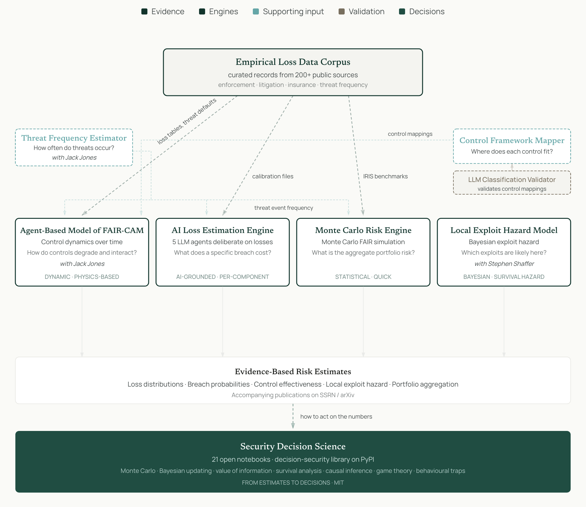

# Security Decision Science

Open-source tools for empirical cyber risk quantification. Built and maintained by Laura Voicu.

[Apropos Security](https://apropos-security.com) · [Medium](https://medium.com/apropos-security) · [LinkedIn](https://www.linkedin.com/in/voiculaura/)

FAIR · FAIR-CAM · Agent-Based Modeling · Monte Carlo · Bayesian · Survival Analysis

More detail: [How the work fits together](https://apropos-security.com/how-it-fits.html)

---

## Projects

### [security-decision-labs](https://github.com/security-decision-science/security-decision-labs) — Tools

Cyber risk quantification toolkit. All tools are CC BY-NC-SA 4.0.

| Tool | What it does                                                                                                                                                                                    | Install |
|------|-------------------------------------------------------------------------------------------------------------------------------------------------------------------------------------------------|---------|
| **[Control Systems ABM](https://github.com/security-decision-science/security-decision-labs/tree/main/tools/control-systems-agent-based-model)** | FAIR-CAM agent-based control dynamics simulation. Eight agent types, three-source variance, budget-constrained remediation, narrative causation. Reproduction package for Jones & Voicu (2026). | `git clone` |
| **[TEF Estimator](https://github.com/security-decision-science/security-decision-labs/tree/main/tools/tef-estimator)** | Data-grounded Threat Event Frequency estimation. Four-vector decomposition, three-anchor triangulation, continuous telemetry monitoring.                                                        | `pip install tef-estimator` |
| **[LLM Classification Validator](https://github.com/security-decision-science/security-decision-labs/tree/main/tools/llm-classification-validator)** | Five-dimension psychometric validation for LLM-generated classifications. Published with [Cloud Security Alliance](https://cloudsecurityalliance.org/).                                         | `pip install llm-classification-validator` |
| **[FAIR Risk Quantification](https://github.com/security-decision-science/security-decision-labs/tree/main/tools/fair-simulator)** | Monte Carlo FAIR risk quantification with IRIS 2025 benchmarks. LEF/LM simulation, portfolio aggregation, sensitivity analysis.                                                                 | `git clone` |

### Related

| Tool | What it does | Status |
|------|--------------|--------|
| **Empirical Loss Data Corpus** | Curated records from 200+ public sources (enforcement, litigation, insurance, threat frequency). Calibrates the engines. | private |
| **[Local Exploit Hazard Model](https://github.com/t0sche/exploit_hazard_model)** | Turns EPSS into a daily exploit hazard for an organisation's own assets; ranks remediations by hazard reduction. With Stephen Shaffer ([arXiv](https://arxiv.org/abs/2607.24618)). MIT. | public |
| **AI Loss Estimation Engine** | Five LLM agents deliberate on losses to produce per-component FAIR loss distributions. | coming soon |
| **Control Framework Mapper** | Maps control frameworks to VERIS A4 and FAIR-CAM; its mappings are checked with the LLM Classification Validator. | private |

### [security-decision-science](https://github.com/security-decision-science/security-decision-science) — Notebooks

21 interactive Jupyter notebooks: statistical foundations, decision frameworks, behavioral traps, causal reasoning applied to security. **[Live docs →](https://security-decision-science.github.io/security-decision-science/)**

### [decision-security](https://github.com/security-decision-science/decision-security) — Python library

Monte Carlo (VaR/ES), Bayesian updates, survival estimation, value-of-information, causal DAGs. `pip install decision-security`

---

Built by [Laura Voicu](https://apropos-security.com) · [Medium](https://medium.com/apropos-security) · [LinkedIn](https://www.linkedin.com/in/voiculaura/)
